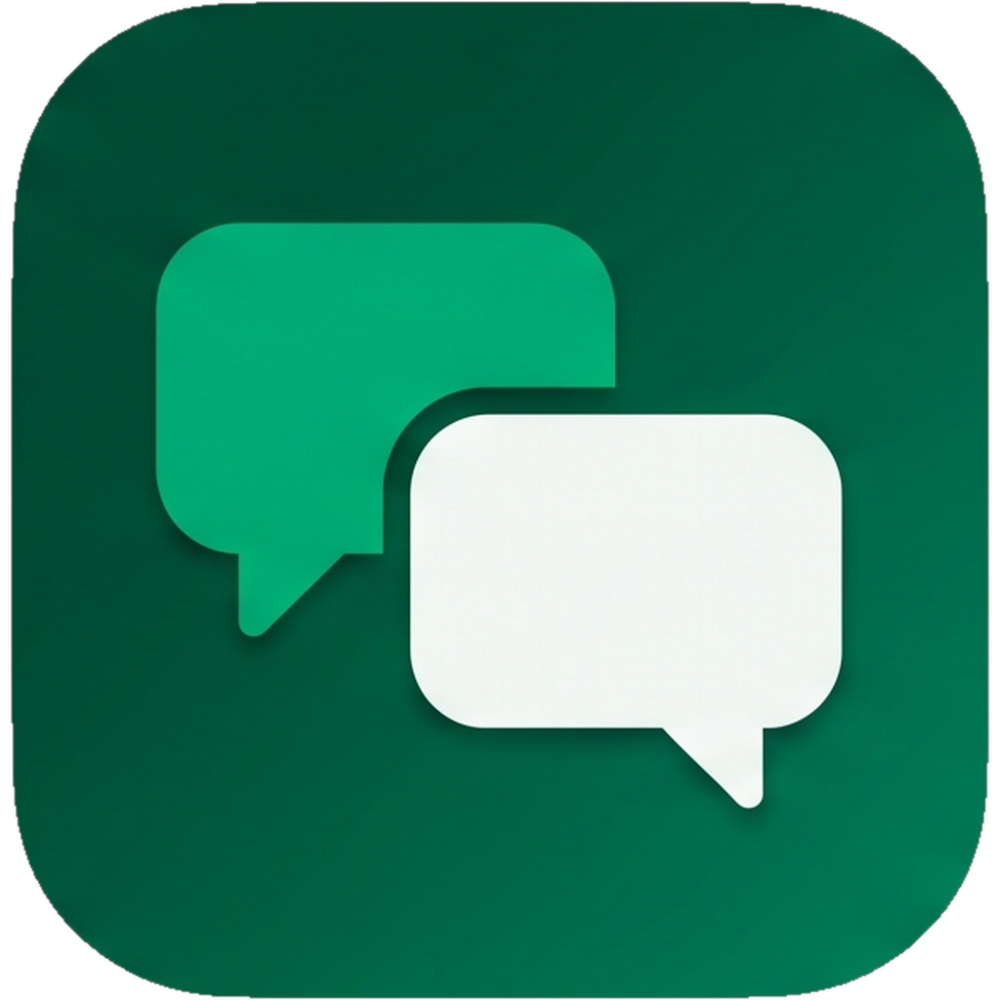

<p align="center"></p>

<h1 align="center">Google Chat Client</h1>

<p align="center">App desktop para usar o Google Chat com várias contas Google Workspace na mesma janela, inclusive de empresas diferentes.</p>

<p align="center"><a href="README.md">English</a> · <strong>Português</strong></p>

Cada conta tem a própria sessão, as próprias conversas, notificações e rascunhos. Roda em Linux, Windows e macOS, em inglês ou português.

> **Projeto independente.** Não é um produto do Google nem tem ligação com o Google. Google, Google Chat e Google Workspace são marcas do Google LLC.

## Baixar

Os instaladores ficam em [Releases](https://github.com/Ruivalim/google-chat-client/releases):

| Sistema | Arquivo |
| --- | --- |
| Linux | `.AppImage` (roda direto), `.deb`, ou `.tar.gz` com `install.sh` |
| Windows | `Google Chat Client Setup … amd64.exe` |
| macOS | `.dmg` universal (Apple Silicon e Intel) |

Os pacotes ainda **não são assinados**. No Windows, o SmartScreen avisa: clique em "Mais informações" e "Executar assim mesmo". No macOS, o Gatekeeper bloqueia na primeira vez: abra em Ajustes do Sistema > Privacidade e Segurança > "Abrir Mesmo Assim".

No Linux, o app precisa do GTK 3, do WebKitGTK 4.1 e de um Secret Service para o chaveiro (GNOME Keyring, KWallet ou KeePassXC). No Debian e no Ubuntu: `sudo apt install libwebkit2gtk-4.1-0 libsecret-1-0`. A bandeja usa `libayatana-appindicator3`. No Windows 10 falta o [WebView2 Runtime](https://developer.microsoft.com/microsoft-edge/webview2/); o 11 já vem com ele.

## Configurar o Google Cloud

O app não vem com credencial embutida: você cria um projeto no Google Cloud e importa o JSON dele. O mesmo passo a passo, com links para cada página do console e um botão de copiar os escopos, fica no app em **Como conectar**.

1. **Crie um projeto só para este app.** O nome que aparece no login (Branding) e as regras de acesso valem para tudo o que usa o projeto. Para ter público **Interno**, crie logado com a conta da empresa, dentro da organização dela; projeto pessoal só oferece Externo.
2. **Ative a Google Chat API** e, na aba Configuração dela, preencha nome, URL de um ícone e descrição, com os recursos interativos desligados. Sem a API ativada nada funciona (`SERVICE_DISABLED`). Sem a configuração, a leitura funciona mas o envio falha com "Google Chat app not found".
3. **Google Auth Platform:**
   - **Branding:** o nome que aparece no login e seu email.
   - **Público:** **Interno** aceita só contas da organização dona do projeto, e quem é de fora toma `org_internal`. **Externo** aceita contas de qualquer empresa.
   - **Acesso a dados:** os escopos da tabela abaixo.
4. **Com público Externo, escolha teste ou produção:**
   - **Em teste**, só entra quem estiver em Público > Usuários de teste (até 100). Conta fora da lista vê "has not completed the Google verification process (...) can only be accessed by developer-approved testers". A sessão vence a cada 7 dias.
   - **Em produção** (Público > Publicar app), a sessão não vence toda semana. Sem verificação, o login mostra a tela de app não verificado, com teto de 100 usuários na vida do projeto. A documentação diz que escopo restrito precisa de verificação em produção; se o Google bloquear o login, volte para teste.
5. **Clientes:** crie um cliente do tipo **Aplicativo para computador**, baixe o JSON, importe no app (Configurações > **Importar arquivo JSON**) e use **Adicionar conta Google**. O login abre no navegador do sistema.

Para fazer o login em outro navegador ou num container (do Firefox ou do Zen, por exemplo), use **Copiar link** enquanto o login está pendente e cole lá. Copie por esse botão: a URL de uma etapa já começada no navegador não funciona em outro container, e o Google responde com um erro 400.

| Escopo | Por quê |
| --- | --- |
| `openid`, `email`, `profile` | Saber qual conta entrou |
| `chat.spaces.readonly` | Listar conversas e espaços |
| `chat.memberships.readonly` | Dar nome às DMs e grupos, que a API entrega sem nome |
| `chat.messages` | Ler e enviar mensagens e anexos |

### Mais de um projeto

Dá para importar vários JSON, um por projeto, e cada conta entra pelo projeto que você escolher em Configurações > Projetos Google Cloud. Serve para dois casos:

- **Fugir dos 7 dias onde dá.** Na empresa em que você é admin, um projeto com público **Interno** não tem sessão vencendo toda semana. As outras empresas continuam num projeto **Externo**.
- **Empresa que exige projeto próprio.** Se o admin de uma empresa só libera app de projeto dela, importe o JSON desse projeto e conecte a conta por ele.

Cada conta renova a sessão com as credenciais do projeto por onde entrou. Um projeto só sai quando nenhuma conta usa ele; para trocar uma conta de projeto, basta conectá-la de novo pelo outro.

### O que esperar do Google

- **Em modo de teste, a sessão vence em 7 dias.** Com público Externo e status *Testing*, o Google emite refresh token que expira em uma semana. Quando expirar, o app avisa e basta adicionar a conta de novo.
- **`chat.messages` é escopo restrito.** Publicado sem verificação, o app mostra a tela de "app não verificado" e aceita no máximo 100 usuários pela vida inteira do projeto. A política diz que escopo restrito não pode ser usado em produção sem revisão; a documentação não diz se o Google só avisa ou bloqueia o login nesse caso.
- **Cada empresa pode bloquear o app.** Se o login de uma conta corporativa der `admin_policy_enforced`, o admin daquele Workspace precisa marcar o client ID como confiável em Admin console > Segurança > Acesso e controle de dados > Controles de API.

Fontes: [publicação e usuários de teste](https://support.google.com/cloud/answer/15549945), [política de escopos em produção](https://developers.google.com/identity/protocols/oauth2/production-readiness/policy-compliance), [expiração de refresh token](https://developers.google.com/identity/protocols/oauth2#expiration), [classificação dos escopos do Chat](https://developers.google.com/workspace/chat/authenticate-authorize), [controle de apps no Workspace](https://knowledge.workspace.google.com/admin/apps/control-which-apps-access-google-workspace-data).

## O que o app faz

- Várias contas, troca pela faixa da esquerda, cada uma identificada pela cor e pelas iniciais da organização; vários projetos Google Cloud, cada conta no seu.
- Lista de conversas paginada, com filtro local e abas de conversas e espaços.
- Histórico paginado, threads em painel lateral, envio e resposta em thread.
- Reenvio seguro: se o envio falhar, o texto fica e a nova tentativa usa o mesmo `requestId`, então o Google não duplica a mensagem.
- Anexos de até 200 MB: enviar (um por mensagem, o texto vai com o primeiro), baixar os recebidos e abrir no Drive os que vêm de lá. Se o envio falhar no meio, a nova tentativa continua de onde parou.
- Notificação do sistema para mensagem nova em qualquer conta, com contador de não lidas. O intervalo (15 s a 5 min) e o liga e desliga ficam em Configurações.
- Bandeja do sistema: fechar a janela esconde o app e as notificações continuam; **Sair** no menu da bandeja encerra.
- Inglês e português, seguindo o sistema ou escolhidos em Configurações. Tema claro, escuro ou do sistema; teclado e leitor de tela tratados.

Token e client secret nunca chegam à interface: ficam no processo Go e no chaveiro do sistema. O `accounts.json` guarda só os projetos importados (client ID e nome) e, de cada conta, nome, email, domínio e o projeto por onde ela entrou.

## Limites conhecidos

- As notificações vêm de consulta periódica, com atraso de até um intervalo, e só com o app aberto (ou na bandeja).
- As não lidas contam desde que o app abriu: sincronizar com o estado de leitura do Google pediria o escopo `chat.users.readstate`.
- Não há indicador de digitação nem presença dos colegas: a API não oferece. Não dá para aceitar convite de espaço pelo app, pela mesma razão.
- Mensagens aparecem como texto e links, sem a formatação do Google Chat nem cards.

Ainda não testado com contas reais: login de uma segunda organização no mesmo projeto Externo, conta entrando por projeto Interno, e os instaladores rodando no Windows e no macOS (até agora eles só foram gerados no CI).

O que a API permite e o que não existe nela está em [docs/google-chat-api.md](docs/google-chat-api.md).

## Próximos passos

1. Não lidas sincronizadas com o Google (`chat.users.readstate`).
2. Eventos em tempo real (Workspace Events API + Pub/Sub), no lugar da consulta periódica.
3. Formatação das mensagens, prévia de imagens e cards.
4. Editar, apagar, reagir, buscar e começar conversa nova.
5. Pacotes assinados (Developer ID no macOS, certificado no Windows).
6. Calendar, Meet (começando por abrir o link) e Gmail.

## Desenvolver

| Parte | O quê |
| --- | --- |
| Janela e empacotamento | [MyGo](https://mygo.egoist.dev) 0.5.5, com a webview do sistema (WebKitGTK, WebView2, WKWebView) |
| Backend | Go 1.27: OAuth, chaveiro do sistema e chamadas à API do Chat |
| Interface | React 19, TypeScript 7, [Fluent UI](https://react.fluentui.dev) 9 |
| Idiomas | Catálogos em `locales/`; o MyGo gera o pacote Go e `src/locales.ts` |

```
main.go, desktop.go     janela, bandeja e os métodos que a interface chama
notify.go, files.go     notificações e arquivos do lado desktop
internal/chat/          OAuth, sessões por conta, API do Chat e o vigia de mensagens
locales/                catálogos de idioma (en é a fonte, pt-BR a tradução)
src/App.tsx             interface
e2e/                    testes de interface com a ponte do MyGo simulada
scripts/appimage.sh     empacota o build Linux como AppImage
```

Precisa de Go 1.27+, [Bun](https://bun.sh) (o MyGo usa para ler a config e rodar as tarefas) e Node 24+.

```sh
make setup      # dependências e o Chromium dos testes
make dev        # app com recarga automática
make preview    # só a interface no navegador, sem login
make check      # lint, testes e build: o mesmo que o CI roda
make build      # pacote da plataforma atual em build/
make appimage   # o build Linux também como AppImage
make build-all  # Linux x64, Windows x64 e macOS universal
```

O `make dev` grava em `Google Chat Client Dev` e o app instalado em `Google Chat Client`, no diretório de configuração do sistema. Os segredos de cada um ficam em serviços separados do chaveiro, então dá para mexer no dev sem tocar nas contas do app de uso.

`make test` roda as duas metades: Go com `-race` contra um Google simulado (OAuth inteiro, renovação concorrente de token, erros da API, vigia de mensagens, upload e download) e a interface no Playwright com a ponte simulada.

Para publicar uma versão, atualize `version` em `mygo.config.ts` e o `CHANGELOG.md`, e envie a tag `v<versão>`: o workflow de release gera os pacotes dos três sistemas e cria o release.

Contribuições são bem-vindas: veja [CONTRIBUTING.md](CONTRIBUTING.md). As decisões visuais estão em [docs/design.md](docs/design.md).

## Licença

[MIT](LICENSE).
